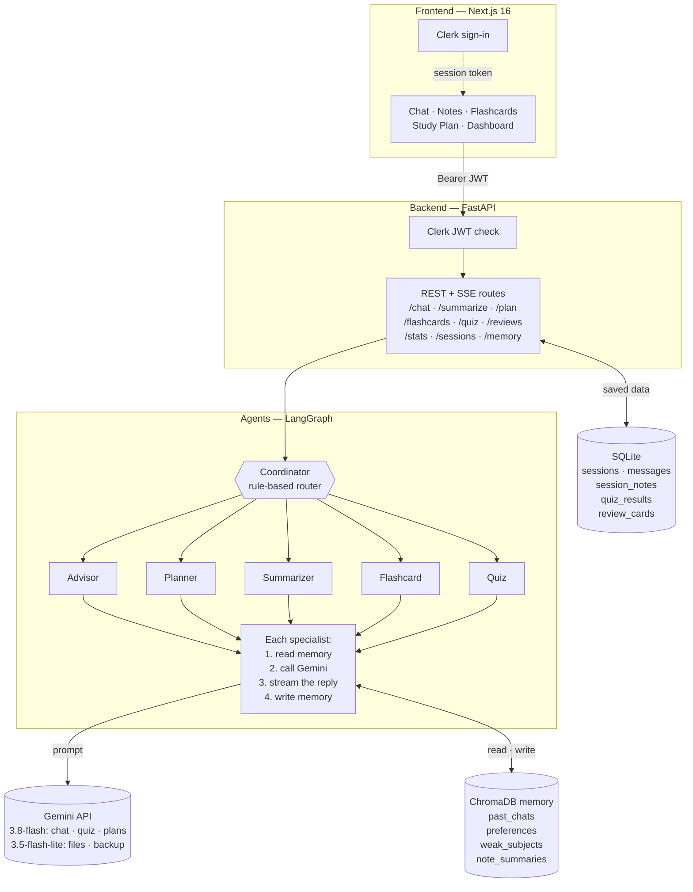

# Athena — AI-Powered Academic Assistant

> *Your quiet study partner. One conversation. Five specialists.*

[](https://nextjs.org)
[](https://fastapi.tiangolo.com)
[](https://langchain-ai.github.io/langgraph)
[](https://clerk.com)
[](https://ai.google.dev)

---

## What is Athena?

Athena is a **stateful, multi-agent AI academic assistant** that replaces 4–5 disconnected study tools with a single platform that gets smarter about you over time.

Athena keeps a **long-term memory of your topics, preferences and weak areas**, **routes each request to the right specialist agent**, and turns your own material into **study tools** — cited summaries, spaced-repetition flashcards, weak-spot quizzes and study plans — not just text.

```
"I have a data structures exam in 3 days"  →  Planner generates a 3-day schedule
"explain binary trees"                     →  Advisor explains with code examples
"create 20 flashcards on binary trees"     →  Flashcard agent returns 20 Q&A pairs
upload a lecture PDF on Notes              →  Summarizer streams a cited summary
"quiz me on photosynthesis"                →  Quiz agent generates 5 MCQs with scoring
```

---

## Key Differentiators

| | General chat assistant | Athena |
|---|---|---|
| Focus | Everything | Built only for studying |
| Agents | One model, one prompt | 5 specialist agents + a router |
| Documents | Answers about a file | Whole-file summary with a page citation per point |
| Flashcards | Plain text | Flip cards with sources, on an SM-2 review schedule |
| Quizzes | Plain text | Scored MCQs; misses become weak areas the next quiz and plan target |
| Study plan | Generic text | Follows your syllabus, prioritises your weak areas, saved |
| Progress | — | Real stats: agent usage, day streak, quiz scores, cards due |

---

## Features

- **5 Specialist Agents + a router** via LangGraph — Advisor, Planner, Summarizer, Flashcard and Quiz, with a rule-based Coordinator that routes each request
- **Long-term Vector Memory** — ChromaDB, one collection per Clerk user: topics you asked about, preferences you state, and weak areas from quizzes and notes
- **Real-time SSE Streaming** — chat replies and file summaries appear as the model writes them
- **Interactive Flashcards** — 10 / 20 / 30 flip cards from any topic, or from a whole uploaded file (cards spread across every part, each citing its page); one click from a Notes summary too
- **Spaced Repetition (SM-2)** — mark each card Got it / Missed it; missed cards come back within minutes and more often, and a "Due for review" deck appears on the Flashcards page and dashboard
- **MCQ Quiz** — 5 questions with instant feedback and final score; scores are saved, missed questions become weak areas, and the next quiz targets them
- **Document Intelligence** — PDF, TXT, MD upload → the whole document is read (long files are noted in parallel parts, then merged) into a streamed, structured summary with page / line citations and a revision checklist; invented page numbers are removed
- **Study Plan Generator** — day-by-day exam preparation from a topic, a past chat or an uploaded syllabus, giving extra time to your weak areas
- **Conversation context** — the last few messages of a chat are sent with each request, so follow-ups like "explain more" work
- **Cross-device Session History** — all chats (including flashcards and quizzes), notes, and plans sync via Clerk auth
- **Dashboard** — memory profile, real agent usage (last 30 days), day streak, recent quiz scores and cards due
- **Export** — download chat as Markdown, summaries as PDF or Markdown
- **Markdown + KaTeX + Syntax Highlighting** — full academic content rendering
- **JWT Security** — every API route except `/health` needs a Clerk token, the user identity comes only from the token, and signed-out visitors are redirected to sign-in
- **Free-tier friendly** — a backup model takes over when the main one is overloaded or out of quota, and students see a clear message instead of a generic error

---

## System Architecture



How a chat message flows:

1. The browser sends the message with the student's Clerk token; FastAPI verifies it and loads the last few messages of the chat.
2. The Coordinator picks one specialist from the message (slash commands win, otherwise keywords at the start).
3. The specialist reads the most relevant memories from ChromaDB, calls Gemini, and streams the reply back over SSE.
4. The reply is saved to SQLite, and the specialist writes a short memory (a topic, a stated preference, or a weak area).

---

## Tech Stack

| Layer | Technology |
|---|---|
| Frontend | Next.js 16 (App Router), React 19, TypeScript, Tailwind CSS 4 |
| Auth | Clerk (RS256 JWT verified with PyJWT, permanent userId, cross-device) |
| Backend | Python 3.11, FastAPI, LangGraph |
| LLM | Google Gemini API via its OpenAI-compatible endpoint: `gemini-3.8-flash` for chat, quizzes and plans, `gemini-3.5-flash-lite` for whole-file summaries / flashcards and as the backup model (free tier works); OpenRouter also supported |
| Memory | ChromaDB vector memory (one collection per user) |
| Database | SQLite via SQLAlchemy async (aiosqlite) |
| Rendering | marked.js + KaTeX + highlight.js, sanitized with DOMPurify |
| Deploy | Docker, Vercel (frontend), Railway (backend) |

---

## Project Structure

```
Athena/
├── backend/
│   ├── app/
│   │   ├── agents/
│   │   │   ├── coordinator/    # Router + workflow
│   │   │   ├── advisor/        # Guidance agent
│   │   │   ├── planner/        # Study schedule agent
│   │   │   ├── summarizer/     # Document agent
│   │   │   ├── flashcard/      # Q&A generation agent
│   │   │   ├── quiz/           # MCQ generation agent
│   │   │   └── shared/         # AcademicState, executor, prompts
│   │   ├── api/                # FastAPI routes
│   │   ├── core/               # Config, auth, database, dependencies
│   │   ├── memory/             # ChromaDB store + async memory provider
│   │   ├── schemas/            # Request/response DTOs
│   │   └── services/           # LLM service, document ingest, SM-2 scheduler
│   ├── tests/              # pytest suite (fake LLM, no API key needed)
│   ├── Dockerfile
│   ├── requirements.txt    # pinned runtime deps
│   ├── requirements-dev.txt
│   └── .env.example
├── frontend/
│   ├── src/
│   │   ├── app/                # Next.js pages
│   │   │   ├── page.tsx        # Landing
│   │   │   ├── chat/           # Chat with streaming
│   │   │   ├── notes/          # Upload + summarize
│   │   │   ├── flashcards/     # Flashcard generator + review session
│   │   │   ├── studyplan/      # Study plan generator
│   │   │   ├── dashboard/      # Memory profile + real stats
│   │   │   └── sign-in/, sign-up/  # Clerk pages
│   │   ├── components/
│   │   │   ├── chat/           # FlashcardDeck, QuizDeck
│   │   │   └── ui/             # Sidebar, AgentBadge, etc.
│   │   └── lib/
│   │       ├── api.ts          # All backend calls
│   │       ├── types.ts        # TypeScript interfaces
│   │       ├── session.ts      # Clerk session management
│   │       ├── renderMarkdown.ts # marked + KaTeX + highlight.js + citation tags
│   │       └── format.ts       # small formatting helpers
│   │   └── proxy.ts            # Clerk route protection (Next.js 16 middleware)
│   ├── Dockerfile
│   └── .env.local.example
└── docker-compose.yml
```

---

## Quick Start (Docker)

**Prerequisites:** Docker + Docker Compose installed

### 1. Clone the repository

```bash
git clone https://github.com/theaadishjain/athena.git
cd athena
```

### 2. Set up environment variables

```bash
# Backend
cp backend/.env.example backend/.env

# Frontend
cp frontend/.env.local.example frontend/.env.local
```

Fill in your keys (see [Environment Variables](#environment-variables) below).

### 3. Run

`NEXT_PUBLIC_*` values are baked into the frontend at build time, so the Clerk
publishable key is passed as a build arg. Put it in a `.env` file next to
`docker-compose.yml` (Compose reads it automatically):

```env
NEXT_PUBLIC_CLERK_PUBLISHABLE_KEY=pk_test_...
# Optional: where the *browser* reaches the backend (default http://localhost:8000)
NEXT_PUBLIC_API_URL=http://localhost:8000
```

```bash
docker compose up --build
```

### 4. Open

```
http://localhost:3000
```

---

## Manual Setup (without Docker)

### Backend

```bash
cd backend
python -m venv venv

# Windows
.\venv\Scripts\activate

# Mac/Linux
source venv/bin/activate

pip install -r requirements.txt
# --reload-dir keeps the reloader from restarting when venv/ changes
uvicorn app.main:app --reload --reload-dir app --port 8000
```

Run the tests (no API keys needed; the LLM is faked):

```bash
pip install -r requirements-dev.txt
python -m pytest tests
```

### Frontend

```bash
cd frontend
cp .env.local.example .env.local
npm install
npm run dev
```

> **No Clerk account yet?** Leave the Clerk keys empty. Clerk runs in *keyless*
> mode and writes temporary dev keys to `frontend/.clerk/.tmp/keyless.json`.
> Copy its `secretKey` into `backend/.env` as `CLERK_SECRET_KEY` so the backend
> accepts the same tokens. If the frontend starts on a port other than 3000,
> add that origin to `CORS_ORIGINS`.

---

## Environment Variables

### Backend (`backend/.env`)

```env
LLM_BASE_URL=https://generativelanguage.googleapis.com/v1beta/openai/
LLM_API_KEY=your-google-ai-studio-key
LLM_MODEL=gemini-3.8-flash
LLM_FALLBACK_MODEL=gemini-3.5-flash-lite   # used when the main model is overloaded / rate-limited
LLM_DOCUMENT_MODEL=gemini-3.5-flash-lite   # faster model for whole-file summaries and flashcards
LLM_MAX_CONCURRENCY=3          # parallel calls for long PDFs; keep low on free tiers
# Or use OpenRouter instead: drop the three LLM_ lines above and set
# OPENROUTER_API_KEY=sk-or-...  and  LLM_MODEL=google/gemini-2.5-flash
CLERK_SECRET_KEY=sk_test_...
# Where the ChromaDB memory store lives (the variable keeps its original name)
MEMPALACE_PATH=~/.mempalace/palace
MEMPALACE_COLLECTION=studyco
MEMORY_TOP_K=3
CORS_ORIGINS=http://localhost:3000
DATABASE_URL=sqlite+aiosqlite:///./studyco.db
APP_URL=http://localhost:3000

# Optional
CLERK_ISSUER=https://your-app.clerk.accounts.dev   # enforce token issuer
CLERK_AUTHORIZED_PARTIES=                          # allowed `azp`; defaults to CORS_ORIGINS
MAX_UPLOAD_MB=10                                   # limit for every file upload
LLM_REASONING_EFFORT=                              # low / medium / high; empty = low on Gemini
CHAT_HISTORY_MESSAGES=10                           # earlier messages sent to the model
```

### Frontend (`frontend/.env.local`)

```env
NEXT_PUBLIC_API_URL=http://localhost:8000
NEXT_PUBLIC_CLERK_PUBLISHABLE_KEY=pk_test_...
CLERK_SECRET_KEY=sk_test_...
NEXT_PUBLIC_CLERK_SIGN_IN_URL=/sign-in
NEXT_PUBLIC_CLERK_SIGN_UP_URL=/sign-up
NEXT_PUBLIC_CLERK_AFTER_SIGN_IN_URL=/dashboard
NEXT_PUBLIC_CLERK_AFTER_SIGN_UP_URL=/dashboard
```

### Where to get keys

| Key | Source |
|---|---|
| `LLM_API_KEY` | [aistudio.google.com/apikey](https://aistudio.google.com/apikey) — free tier (Google may use free-tier requests to improve its products) |
| `OPENROUTER_API_KEY` (optional alternative) | [openrouter.ai/keys](https://openrouter.ai/keys) |
| `CLERK_SECRET_KEY` + `CLERK_PUBLISHABLE_KEY` | [clerk.com/dashboard](https://clerk.com/dashboard) — free account |

### Using the Gemini free tier

- Free-tier quotas are per model and per day. When `LLM_MODEL` is overloaded (503) or out of quota (429), requests switch straight to `LLM_FALLBACK_MODEL`, which has its own quota.
- Long PDFs are split into parts; `LLM_MAX_CONCURRENCY` caps how many are sent at once so the per-minute limit isn't hit.
- Google may use free-tier requests (including uploaded notes) to improve its products. Use a paid key before real users upload their material.

---

## Agent System

Chat messages go through a single `/chat` endpoint, where the Coordinator (a rule-based router, not an LLM) picks one specialist per message. Slash commands always win; otherwise only the start of the message is matched, so pasted notes don't change the route.

| Agent | Trigger keywords | Output |
|---|---|---|
| **Advisor** | explain, what/why/how questions, `/explain`, `/solve` (default) | Streaming text (brief/detailed auto-mode) |
| **Planner** | plan, schedule, timetable, deadline, exam + a time frame ("in 3 days", "next week"), `/plan`; Study Plan page (optional syllabus file) | Day-by-day schedule that prioritises your weak areas |
| **Summarizer** | summarize, summary, tl;dr, `/summarize` (pasted text in chat); Notes page for files | Structured summary + checklist; files get `[p. N]` / `[L12–40]` citations |
| **Flashcard** | flashcard(s), make cards, memorize, `/flashcards`; Flashcards page / Notes with a file | 10/20/30 Q&A flip cards (with `p. N` sources from files) |
| **Quiz** | quiz, quiz me, test me, mcq, practice questions, `/quiz` | 5 MCQ with scoring, aimed at your weak areas |

### Memory write ownership (by convention: each agent writes only these types)

| Agent | Writes to |
|---|---|
| Advisor | `past_chats`, `preferences` |
| Planner | `past_chats`, `preferences` |
| Summarizer | `note_summaries`, `weak_subjects` |
| Flashcard | `past_chats` |
| Quiz | `past_chats` (finished quizzes: `POST /quiz/results` writes missed questions to `weak_subjects`) |

---

## API Routes

All routes except `/health` require `Authorization: Bearer <clerk_jwt>` header.

```
GET  /health                        → { status: "ok" }
POST /chat                          → SSE stream: `token` events, then one `done` event
                                      (saves both messages; `persist: false` for one-off calls)
POST /plan                          → UnifiedResponse JSON
POST /plan/syllabus                 → multipart/form-data (file, input) → study plan following an uploaded syllabus
POST /summarize                     → multipart/form-data (file, session_id) → UnifiedResponse with a cited summary
POST /summarize/stream              → same, as SSE: `token` events, then a `done` event with the citation-checked text
POST /flashcards/document           → multipart/form-data (file, count) → UnifiedResponse with flashcards from the whole file
POST /extract                       → multipart/form-data → { filename, text } (plain-text preview, first 8,000 chars)
POST /quiz/results                  → save a finished quiz { topic, score, total, missed[] }; misses → weak area
GET  /quiz/results                  → recent quiz attempts
POST /reviews/grade                 → grade a card Got it / Missed it (first grade adds it to the SM-2 schedule)
GET  /reviews/due                   → cards due now, most overdue / most missed first
GET  /stats                         → agent usage, day streak, recent quiz scores, cards due
GET  /memory/profile                → { preferences, weak_subjects, recent_topics }
GET  /memory                        → read memories of one type (query, k)
POST /memory                        → write a memory
GET  /sessions                      → list user sessions
POST /sessions                      → create session
GET  /sessions/{id}/messages        → load chat history
POST /sessions/{id}/messages        → save message
GET  /sessions/{id}/notes           → notes saved in one session
POST /sessions/{id}/notes           → save a note (summary, plan or chat answer)
GET  /sessions/notes/all            → past summaries + study plans
DELETE /sessions/{id}               → delete session and its messages (notes are kept)
DELETE /sessions/empty              → cleanup empty sessions
```

### UnifiedResponse schema

```typescript
{
  status: "success" | "error"
  agent: "planner" | "summarizer" | "advisor" | "coordinator" | "flashcard" | "quiz"
  response: string
  memory_updated: boolean
  fallback: boolean
  flashcards?: { question: string; answer: string; source?: string | null }[]  // source e.g. "p. 12"
  quiz?: { question: string; options: string[]; correct: string; explanation: string }[]
}
```

---

## Deployment

### Frontend → Vercel

1. Connect GitHub repo to [vercel.com](https://vercel.com)
2. Set root directory to `frontend/`
3. Add environment variables from `frontend/.env.local`
4. Update `NEXT_PUBLIC_API_URL` to your Railway backend URL
5. Deploy

### Backend → Railway

1. Connect GitHub repo to [railway.app](https://railway.app)
2. Set root directory to `backend/`
3. Railway auto-detects `backend/Dockerfile`
4. Add environment variables from `backend/.env`
5. Add persistent volume mounted at `/data`
6. Update env vars:
   ```
   MEMPALACE_PATH=/data/mempalace/palace
   DATABASE_URL=sqlite+aiosqlite:////data/studyco.db
   CORS_ORIGINS=https://your-vercel-domain.vercel.app
   APP_URL=https://your-railway-domain.up.railway.app
   ```
7. Switch Clerk keys from `pk_test_` / `sk_test_` to `pk_live_` / `sk_live_`

---

## Future Roadmap

- [ ] RAG over PDFs — query specific textbook sections
- [ ] Voice transcription (Whisper) — lecture recording → notes
- [ ] Export to Notion
- [ ] Phone layout (the web app is desktop-first today)
- [ ] Mobile app (React Native)
- [ ] Charts of quiz scores and review accuracy over time
- [ ] Onboarding flow — personalize from day one

---

## Built By

**Aadish Jain** · **G Sai Bharadwaj** · **D Kanishq**

B.Tech Computer Science and Engineering
SRM Institute of Science and Technology, Kattankulathur
Under the guidance of **Dr. Dinesh G**, Associate Professor

Course: 21CSE733T — Agent Ops and Industrial-Scale AI Deployment

---

## References

1. [LangGraph Documentation](https://langchain-ai.github.io/langgraph/)
2. [Gemini API (OpenAI compatibility)](https://ai.google.dev/gemini-api/docs/openai)
3. [OpenRouter API](https://openrouter.ai/docs)
4. [Clerk Authentication](https://clerk.com/docs)
5. [FastAPI](https://fastapi.tiangolo.com)
6. [Next.js App Router](https://nextjs.org/docs)
7. [ChromaDB](https://docs.trychroma.com)
8. [NirDiamant — GenAI Agents](https://github.com/NirDiamant/GenAI_Agents)

---

*Athena · v4.0 · MMXXVI*
